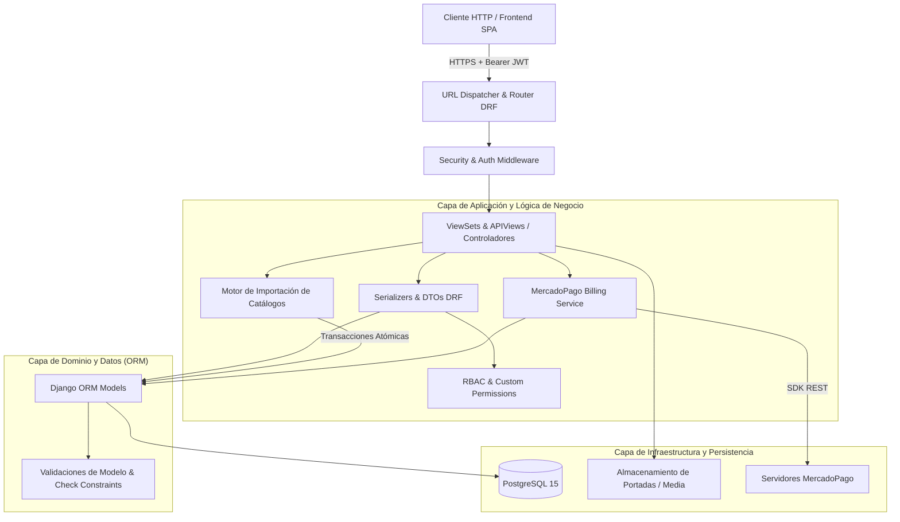
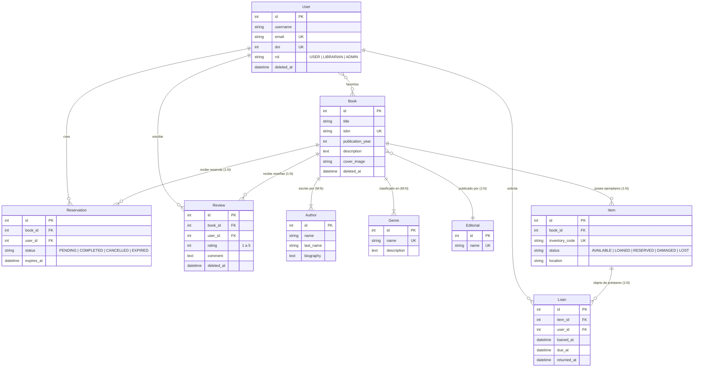

# Folium API — Motor Bibliográfico y Servicio Central RESTful


---

## 1. Visión General y Propósito del Sistema

**Folium API** es el núcleo de persistencia, lógica de negocio y procesamiento de datos para la plataforma bibliotecaria Folium. Ha sido diseñada como una API RESTful modular, segura y altamente escalable, orientada a bibliotecas académicas, archivos históricos y colecciones privadas.

El backend gestiona el ciclo de vida completo de los recursos bibliográficos:
- Catalogación estructurada de obras literarias, autores, editoriales y materias.
- Trazabilidad de inventario físico por ejemplar individual con códigos de barra y ubicaciones topográficas en sala.
- Circulación automatizada (préstamos con control de vencimiento y cálculo de mora).
- Sistema de reservas concurrentes y reseñas comunitarias.
- Motor transaccional de importación masiva de catálogos en múltiples estándares internacionales (**MARC 21 ISO 2709**, **MARCXML**, **BibTeX**, **Excel** y **CSV**).
- Facturación institucional integrada con la pasarela de pagos de **MercadoPago** (preferencias de suscripción y webhooks idempotentes).

---

## 2. Arquitectura del Sistema y Patrones de Diseño

El backend adopta una **Arquitectura en Capas Limpia (Layered Clean Architecture)** que aísla estrictamente las responsabilidades entre transporte HTTP, lógica de dominio, persistencia en base de datos e integraciones con servicios de terceros.



### Principales Patrones de Diseño Aplicados

1. **Patrón Strategy & Parser Registry (Motor de Importación)**:
   La función `parse_uploaded_file` en [`importer_views.py`](file:///c:/Users/Facundo/Desktop/ReposGit/folium-api/folium_api/importer_views.py) implementa el patrón Estrategia mediante detección polimórfica (por extensión y sniffing byte-level de cabecera). Delega dinámicamente en parsers especializados (`parse_marc21_bytes`, `parse_marcxml_bytes`, `parse_bibtex_text`, `parse_excel_bytes`, `parse_csv_bytes`) sin acoplar la vista a ningún formato específico.
2. **Patrón Service Object (Desacoplamiento de Pagos)**:
   La interacción con la pasarela de MercadoPago está encapsulada en [`mercadopago_service.py`](file:///c:/Users/Facundo/Desktop/ReposGit/folium-api/folium_api/mercadopago_service.py), abstrayendo la SDK oficial, la construcción de preferencias, el catálogo de planes en memoria y la verificación de webhooks.
3. **Patrón Adapter / Serializer (DRF)**:
   Los serializadores transforman entidades del ORM en contratos JSON estándar para el cliente y normalizan las entradas externas (por ejemplo, saneamiento de strings y validación de dígitos de ISBN).
4. **Transacciones Atómicas (`ACID Transactions`)**:
   Tanto en la ejecución del importador masivo como en el procesamiento de préstamos y devoluciones, se utiliza `transaction.atomic()`. Si un solo registro de un lote falla en modo estricto, la base de datos realiza un rollback completo, garantizando cero estados inconsistentes.
5. **Máquina de Estados Finita (FSM) para Ejemplares y Reservas**:
   Las transiciones de estado de `Item.status` (`AVAILABLE` → `LOANED` → `AVAILABLE` / `DAMAGED` / `LOST`) y `Reservation.status` (`PENDING` → `COMPLETED` / `CANCELLED` / `EXPIRED`) están controladas mediante validaciones explícitas en los métodos `clean()` de los modelos, impidiendo que ejemplares dañados o perdidos vuelvan a estar disponibles sin auditoría previa.
6. **Borrado Lógico (Soft Delete)**:
   Entidades críticas como `Book`, `User` y `Review` implementan el campo `deleted_at`. Las consultas habituales excluyen registros con marca de borrado preservando la integridad referencial histórica para préstamos pasados y estadísticas.

---

## 3. Modelo de Dominio y Esquema de Base de Datos



### Detalle de Modelos y Reglas de Negocio

#### `Book`
- **Campos**: `title` (máx. 45), `editorial` (FK protegida `PROTECT`), `isbn` (10 o 13 dígitos numéricos o nulo), `publication_year` (validado entre año 868 y el año en curso), `description`, `cover_image` (`books/covers/`), marcas temporales y `deleted_at`.
- **Relaciones**: Many-to-Many con `Author` y `Genre`.
- **Índices**: `book_deleted_at_idx`, `book_pub_year_idx`, `book_title_idx`.

#### `Item`
- **Campos**: `book` (FK protegida `PROTECT`), `inventory_code` (único, ej. `INV-GABO-01`), `status` (`AVAILABLE`, `LOANED`, `RESERVED`, `DAMAGED`, `LOST`), `location` (ej. `Sala A - Estante 3`).
- **Regla de integridad**: Un ítem en estado `LOST` o `DAMAGED` tiene prohibido regresar a `AVAILABLE` mediante edición directa sin revisión técnica previa.
- **Índices**: `item_status_idx`, `item_book_status_idx`.

#### `User` (Hereda de `AbstractUser`)
- **Campos**: `email` (único y obligatorio), `dni` (número positivo único), `rol` (`USER`, `LIBRARIAN`, `ADMIN`), relación `favorites` M:N con `Book`, y `deleted_at` para soft delete.
- **Validaciones**: Sanitización de nombres con regex alfabético con soporte de tildes y caracteres internacionales (`^[a-zA-ZÀ-ÿ\s'-]+$`).

#### `Loan`
- **Campos**: `item` (FK), `user` (FK), `loaned_at`, `due_at`, `returned_at`.
- **Reglas**: `due_at` debe ser estrictamente posterior a `loaned_at`; `returned_at` no puede ser anterior al inicio del préstamo.
- **Índices**: `loan_returned_at_idx`, `loan_due_at_idx`, `loan_user_ret_idx`.

#### `Reservation`
- **Campos**: `book` (FK), `user` (FK), `status` (`PENDING`, `COMPLETED`, `CANCELLED`, `EXPIRED`), `expires_at`.
- **Reglas**: Fecha de expiración estrictamente en el futuro al crear la reserva; unicidad de reservas activas (`PENDING`) por par `(user, book)`.
- **Índices**: `res_status_idx`, `res_book_status_idx`, `res_user_status_idx`.

#### `Review`
- **Campos**: `book` (FK), `user` (FK), `rating` (entero entre 1 y 5), `comment`, `deleted_at`.
- **Reglas**: Máximo una reseña activa por usuario para cada obra literaria.
- **Índices**: `review_deleted_at_idx`, `review_book_del_idx`, `review_rating_idx`.

---

## 4. Motor de Importación Masiva de Catálogos

Ubicado en [`folium_api/importer_views.py`](file:///c:/Users/Facundo/Desktop/ReposGit/folium-api/folium_api/importer_views.py), este módulo permite a los bibliotecarios cargar lotes enteros de libros y ejemplares mediante un asistente en 4 fases:

```
[Archivo Subido] ──> 1. PREVIEW ──> 2. AUTO-MAPPING ──> 3. SIMULATE (Dry Run) ──> 4. EXECUTE (Atomic Commit)
```

### Formatos Soportados y Algoritmos de Parseo

| Formato | Extensiones | Parser / Detección | Características Técnicas |
| :--- | :--- | :--- | :--- |
| **MARC 21 Binario** | `.mrc`, `.marc`, `.dat` | `parse_marc21_bytes` (ISO 2709) | Decodifica líder de 24 bytes, extrae directorio de etiquetas de 12 bytes, lee subcampos delimitados por `\x1f`, terminadores de campo `\x1e` y de registro `\x1d`. Normaliza puntuación ISBD. |
| **MARCXML** | `.xml`, `.marcxml` | `parse_marcxml_bytes` (XML ElementTree) | Soporta namespace oficial de la Library of Congress (`http://www.loc.gov/MARC21/slim`), procesando `<controlfield>` y `<datafield>` anidados. |
| **BibTeX** | `.bib` | `parse_bibtex_text` (Regex AST) | Extrae entradas `@book{...}`, mapeando campos `title`, `author`, `isbn`, `publisher`, `year`, `keywords`, `abstract`. |
| **Planillas Excel** | `.xlsx` | `parse_excel_bytes` (Zipfile + XML) | Lector ligero nativo sin dependencias pesadas tipo openpyxl/pandas. Extrae `sharedStrings.xml` y celdas de `sheet1.xml`. |
| **Delimitados CSV/TSV** | `.csv`, `.tsv`, `.txt` | `parse_csv_bytes` (`csv.Sniffer`) | Detección automática de codificación (`UTF-8`, `UTF-8-SIG` con BOM, `Latin-1`, `CP1252`) y delimitador (`;`, `,`, `\t`, `\|`). |

### Normalización de Etiquetas MARC a Esquema Folium

- **Título (`245`)**: Concatena `$a` y `$b`, depurando signos terminales de catalogación (` /:;,.=`).
- **Autor (`100` / `700` / `110`)**: Invierte automáticamente la sintaxis angloamericana `"Apellido, Nombre"` a `"Nombre Apellido"`, limpiando fechas vitales (`$d`).
- **ISBN (`020`)**: Valida y extrae dígitos eliminando sufijos explicativos tipo `(rústica)`.
- **Editorial (`264 $b` / `260 $b`)**: Compatible con normas modernas RDA y tradicionales AACR2.
- **Año (`264 $c` / `260 $c` / `008`)**: Extrae año de 4 cifras con fallback a la posición 7-10 del campo de control de longitud fija `008`.
- **Género (`650` / `655`)**: Extrae descriptores temáticos y de forma literaria.
- **Signatura / Código de Ejemplar (`852 $p` / `952 $p` / `082` / `001`)**: Lee códigos de inventario físico (compatible con Koha ILS) y clasificación Dewey.
- **Ubicación (`852 $c`, `$h`)**: Estantería y clasificación física en sala.
- **Sinopsis (`520 $a` / `500 $a`)**: Resúmenes y notas generales.

---

## 5. Módulo de Facturación y Suscripciones (MercadoPago)

Ubicado en [`folium_api/mercadopago_service.py`](file:///c:/Users/Facundo/Desktop/ReposGit/folium-api/folium_api/mercadopago_service.py) y [`folium_api/billing_views.py`](file:///c:/Users/Facundo/Desktop/ReposGit/folium-api/folium_api/billing_views.py):

- **Catálogo de Planes Institucionales**:
  - `PLAN_POPULAR` ($29.900 ARS/mes): Hasta 5.000 títulos, importador masivo completo (Excel, CSV, BibTeX, MARC 21, MARCXML), 3 cuentas de bibliotecario.
  - `PLAN_ACADEMIC` ($59.900 ARS/mes): Hasta 25.000 títulos, 10 bibliotecarios, soporte de preservación digital.
  - `PLAN_NETWORK` ($119.900 ARS/mes): Obras ilimitadas, multi-sucursal, API dedicada.
- **Flujo de Pago**:
  1. El cliente envía `POST /api/v1/billing/checkout/` con el `plan_id`.
  2. El servicio genera la preferencia en MercadoPago configurando `back_urls` (éxito, fallo, pendiente), `auto_return: approved` y metadatos de auditoría.
  3. Devuelve `init_point` para redirección transparente del usuario.
  4. Los eventos de notificación IPN son recibidos en `POST /api/v1/billing/webhook/mercadopago/`, consultando el estado del pago mediante el SDK oficial y activando los permisos institucionales.

---

## 6. Catálogo de Endpoints de la API

Todas las rutas están prefijadas por `/api/v1/`.

### Autenticación y Cuentas
| Método | Endpoint | Acceso | Descripción |
| :--- | :--- | :--- | :--- |
| `POST` | `/token/` | Público | Obtención de tokens JWT (`access` y `refresh`) mediante `username` y `password`. Devuelve claims con rol. |
| `POST` | `/token/refresh/` | Público | Renovación del `access` token mediante un `refresh` token válido. |
| `POST` | `/register/` | Público | Autoregistro de nuevos lectores (`USER`). Valida DNI, email y contraseña. |
| `GET` | `/me/` | Autenticado | Perfil detallado del usuario en sesión, estadísticas de lectura y rol. |
| `PATCH` | `/me/` | Autenticado | Actualización de datos de perfil (nombre, apellido, teléfono). |

### Catálogo y Libros (`/book/`)
| Método | Endpoint | Acceso | Descripción |
| :--- | :--- | :--- | :--- |
| `GET` | `/book/` | Público | Listado paginado de libros con filtros multicriterio (`search`, `genre`, `editorial`, `year`). Optimizado con `select_related`/`prefetch_related`. |
| `POST` | `/book/` | Staff (`LIBRARIAN`, `ADMIN`) | Alta de obra con autores, géneros y subida multipart de portada (`cover_image`). |
| `GET` | `/book/{id}/` | Público | Ficha técnica completa de la obra, autores, géneros, stock disponible y promedio de calificaciones. |
| `PUT`/`PATCH` | `/book/{id}/` | Staff | Modificación de metadatos de la obra. |
| `DELETE` | `/book/{id}/` | Staff | Borrado lógico (`deleted_at = timezone.now()`). |
| `GET` | `/random/` | Público | Devuelve un libro aleatorio para recomendaciones en landing. |
| `GET` | `/recommendations/` | Público | Sugerencias literarias basadas en popularidad o similitud. |

### Ejemplares Físicos (`/items/`)
| Método | Endpoint | Acceso | Descripción |
| :--- | :--- | :--- | :--- |
| `GET` | `/items/` | Staff | Listado de ejemplares con filtros por código de inventario, libro y estado. |
| `POST` | `/items/` | Staff | Registro de nuevo ejemplar vinculado a un libro (`inventory_code`, `status`, `location`). |
| `PATCH` | `/items/{id}/` | Staff | Cambio de estado o reubicación de sala. |

### Circulación y Préstamos (`/loan/`)
| Método | Endpoint | Acceso | Descripción |
| :--- | :--- | :--- | :--- |
| `GET` | `/loan/` | Autenticado | Si es `USER`, lista sus propios préstamos. Si es `LIBRARIAN`/`ADMIN`, lista préstamos globales con filtro por mora. |
| `POST` | `/loan/` | Staff | Creación de préstamo asociando un `Item` disponible a un `User`. Cambia el estado del ítem a `LOANED`. |
| `POST` | `/loan/{id}/return_book/` | Staff | Registra `returned_at = now()` y devuelve el ítem a `AVAILABLE` de forma atómica. |

### Reservas (`/reservations/`)
| Método | Endpoint | Acceso | Descripción |
| :--- | :--- | :--- | :--- |
| `GET` | `/reservations/` | Autenticado | Lista reservas del usuario o del sistema según rol. |
| `POST` | `/reservations/` | Autenticado (`USER`) | Reserva un libro sin stock disponible inmediato. Asigna fecha de expiración por defecto. |
| `PATCH` | `/reservations/{id}/` | Autenticado | Cancelación voluntaria por parte del usuario o resolución por bibliotecario. |

### Reseñas (`/reviews/`)
| Método | Endpoint | Acceso | Descripción |
| :--- | :--- | :--- | :--- |
| `GET` | `/reviews/?book={id}` | Público | Lista de reseñas y comentarios aprobados para un libro. |
| `POST` | `/reviews/` | Autenticado (`USER`) | Publica una calificación (1 a 5) y comentario para una obra leída. |

### Importador Masivo (`/importer/`)
| Método | Endpoint | Acceso | Descripción |
| :--- | :--- | :--- | :--- |
| `POST` | `/importer/preview/` | Staff | Carga del archivo binario/texto. Detecta formato, total de filas, columnas y sugiere mapeo inteligente. |
| `POST` | `/importer/simulate/` | Staff | Ejecuta un dry-run validando cada fila contra las restricciones del ORM sin persistir cambios en BD. |
| `POST` | `/importer/execute/` | Staff | Ejecución transaccional (`transaction.atomic()`). Persiste autores, editoriales, obras y ejemplares. |

### Facturación Institucional (`/billing/`)
| Método | Endpoint | Acceso | Descripción |
| :--- | :--- | :--- | :--- |
| `GET` | `/billing/plans/` | Público | Catálogo con tarifas y límites técnicos de cada plan. |
| `POST` | `/billing/checkout/` | Autenticado | Genera la preferencia de pago en MercadoPago para el plan solicitado. |
| `POST` | `/billing/webhook/mercadopago/` | Público (Firma MP) | Receptor de notificaciones asíncronas de acreditación de pagos. |

---

## 7. Seguridad, Autorización y RBAC

1. **Tokens JWT Personalizados**:
   Implementados con `django-rest-framework-simplejwt`. La vista `FoliumTokenObtainPairView` inyecta en el payload del token los claims `user_id`, `username`, `email` y `rol`, permitiendo al frontend tomar decisiones de renderizado inmediato sin peticiones adicionales.
2. **Matriz de Control de Acceso (RBAC)**:
   - `IsLibrarianOrAdminUser`: Permiso personalizado que valida si `request.user.rol` es `LIBRARIAN` o `ADMIN`, o si el usuario tiene `is_staff=True`.
   - Restricción por Ownership: En vistas como `/reservations/` o `/loan/`, los lectores solo pueden consultar y operar sobre sus propios registros, mientras que los bibliotecarios tienen visibilidad global.
3. **Validación Criptográfica y de Integridad**:
   - Algoritmo de verificación de ISBN (10 y 13 dígitos) con cálculo de dígito verificador.
   - Prevención de inyección SQL mediante el uso estricto del compilador de consultas del ORM de Django (sin `raw SQL` concatenado).
   - Sanitización de nombres contra vectores XSS mediante expresiones regulares en los modelos.
4. **Protección de Datos y Manejo de Errores**:
   - En modo producción (`DEBUG=False`), los errores 500 omiten trazas internas sensibles y devuelven respuestas JSON homogéneas.

---

## 8. Optimización de Consultas y Rendimiento

Para garantizar tiempos de respuesta inferiores a 100 ms en catálogos de más de 50.000 libros:
- **Eliminación de consultas N+1**:
  Todos los ViewSets de libros emplean:
  ```python
  Book.objects.select_related('editorial') \
              .prefetch_related('authors', 'genres', 'items') \
              .filter(deleted_at__isnull=True)
  ```
- **Indexación Estratégica**:
  Índices compuestos B-Tree en PostgreSQL para búsquedas frecuentes (`book_deleted_at_idx`, `item_book_status_idx`, `res_book_status_idx`, `loan_user_ret_idx`).
- **Paginación en Servidor**:
  Paginación automática de 20 registros por página (`PageNumberPagination`), evitando sobrecarga en memoria y transferencia innecesaria de payloads JSON gigantescos.

---

## 9. Variables de Entorno

Crear un archivo `.env` en la raíz de `folium-api` basándose en `.env.example`:

```bash
# Django Core
SECRET_KEY=clave_secreta_fuerte_de_django
DEBUG=True
ALLOWED_HOSTS=localhost,127.0.0.1,web

# Base de Datos PostgreSQL
POSTGRES_DB=folium_db
POSTGRES_USER=folium_user
POSTGRES_PASSWORD=folium_secure_password
DB_HOST=db
DB_PORT=5432

# Pasarela de Pagos (MercadoPago)
MERCADOPAGO_ACCESS_TOKEN=APP_USR-xxxx-xxxx-xxxx
MERCADOPAGO_PUBLIC_KEY=APP_USR-yyyy-yyyy-yyyy
MERCADOPAGO_WEBHOOK_SECRET=tu_secreto_webhook

# URL Pública de la Aplicación (para callbacks y portadas)
FRONTEND_URL=http://localhost:5173
API_BASE_URL=http://localhost:8080
```

---

## 10. Despliegue y Ejecución Local con Docker

### Inicio Rápido con Docker Compose

```bash
# 1. Construir las imágenes e iniciar contenedores (Django + PostgreSQL)
docker compose up --build -d

# 2. Aplicar migraciones del esquema de base de datos
docker compose exec web python manage.py migrate

# 3. Crear usuario administrador inicial
docker compose exec web python manage.py createsuperuser

# 4. Inspeccionar logs en vivo
docker compose logs -f web
```

La API quedará escuchando en `http://localhost:8080/api/v1/` y el panel de administración en `http://localhost:8080/admin/`.

### Ejecución de Pruebas Unitarias

```bash
# Ejecutar toda la suite de pruebas automatizadas
docker compose exec web python manage.py test folium_api

# Ejecutar exclusivamente los tests del motor de importación MARC
docker compose exec web python manage.py test folium_api.tests.MarcImporterTests
```
