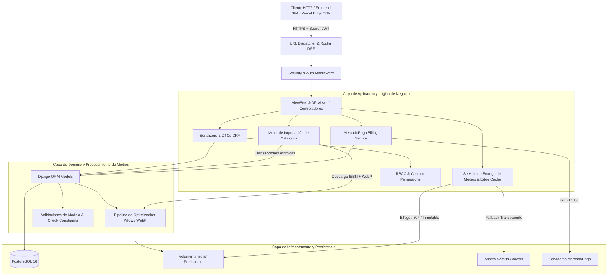
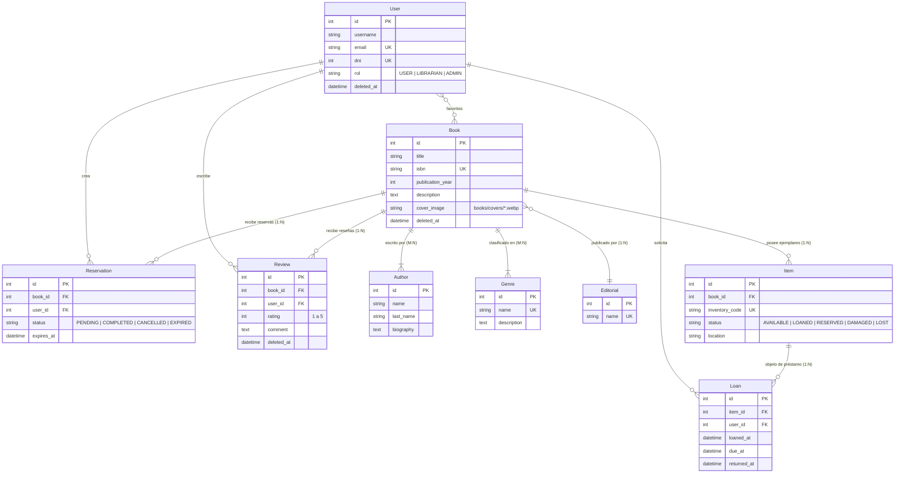

# Folium API — Motor Bibliográfico y Servicio Central RESTful


---

## 1. Visión General y Propósito del Sistema

**Folium API** es el núcleo de persistencia, lógica de negocio y procesamiento de datos para la plataforma bibliotecaria Folium. Ha sido diseñada como una API RESTful modular, segura y altamente escalable, orientada a bibliotecas académicas, archivos históricos y colecciones privadas.

El backend gestiona el ciclo de vida completo de los recursos bibliográficos:
- Catalogación estructurada de obras literarias, autores, editoriales y materias.
- Pipeline de optimización multimedia automática en tiempo real con compresión WebP y redimensionado inteligente.
- Trazabilidad de inventario físico por ejemplar individual con códigos de barra y ubicaciones topográficas en sala.
- Circulación automatizada (préstamos con control de vencimiento y cálculo de mora).
- Sistema de reservas concurrentes y reseñas comunitarias.
- Motor transaccional de importación masiva de catálogos en múltiples estándares internacionales (**MARC 21 ISO 2709**, **MARCXML**, **BibTeX**, **Excel** y **CSV**).
- Facturación institucional integrada con la pasarela de pagos de **MercadoPago** (preferencias de suscripción y webhooks idempotentes).

---

## 2. Arquitectura del Sistema y Patrones de Diseño

El backend adopta una **Arquitectura en Capas Limpia (Layered Clean Architecture)** que aísla estrictamente las responsabilidades entre transporte HTTP, lógica de dominio, persistencia en base de datos e integraciones con servicios de terceros.



### Principales Patrones de Diseño Aplicados

1. **Pipeline de Procesamiento de Medios (Pillow + WebP Optimization)**:
   Ubicado en `folium_api/image_utils.py`. Todas las imágenes subidas a través de `Book.save()` o recuperadas externamente mediante el importador de ISBN son interceptadas, orientadas según metadatos EXIF, redimensionadas proporcionalmente con filtro `LANCZOS` a un máximo de `600×900 px` y codificadas en **WebP (`quality=82`)**.
2. **Entrega de Medios Compatible con Edge CDN (`media_views.py`)**:
   Implementado en `folium_api/media_views.py`. Sirve archivos estáticos multimedia tanto en desarrollo como en producción (`DEBUG=False`), incluyendo fallback transparente a `.webp`, `ETag`, `Last-Modified`, `304 Not Modified` y cabeceras `Cache-Control` / `Vercel-CDN-Cache-Control`.
3. **Patrón Strategy & Parser Registry (Motor de Importación)**:
   `parse_uploaded_file` en `folium_api/importer_views.py` detecta el formato por extensión y contenido y delega en `parse_xlsx_file`, `parse_csv_file`, `parse_bib_file`, `parse_marc21_bytes` y `parse_marcxml_bytes`, aplicando límites defensivos (10 MB de entrada, 50 MB XLSX descomprimido anti-zip-bomb, 10.000 filas y bloqueo de declaraciones XML `DOCTYPE`/`ENTITY`).
4. **Patrón Service Object (Desacoplamiento de Pagos)**:
   La integración con MercadoPago vive en `folium_api/mercadopago_service.py` y `folium_api/billing_views.py`. La simulación local (`LOCAL_SIMULATION`) queda restringida a `DEBUG=True`; en producción (`DEBUG=False`) exige `MP_ACCESS_TOKEN`, firma HMAC-SHA256 en webhooks y validación estricta de `currency_id` y monto mínimo bajo `select_for_update()`.
5. **Transacciones Atómicas y Bloqueo de Fila (`ACID Transactions`)**:
   El importador masivo, la activación de suscripciones y la creación/actualización de préstamos (`LoanWriteSerializer`) utilizan `transaction.atomic()` junto con `select_for_update()` y la restricción parcial única `uniq_active_loan_per_item` en PostgreSQL para evitar dobles préstamos concurrentes.
6. **Máquina de Estados Finita (FSM) para Ejemplares y Reservas**:
   Las transiciones de `Item.status` (`AVAILABLE`, `LOANED`, `RESERVED`, `DAMAGED`, `LOST`) se validan en `ItemSerializer` y `ItemViewSet`: los estados `LOANED`/`RESERVED` se gestionan únicamente desde préstamos y reservas, la rehabilitación de `DAMAGED`/`LOST` hacia `AVAILABLE` exige `POST /api/v1/items/{id}/mark-reviewed/`, y la eliminación de ejemplares con préstamos o reservas vigentes está bloqueada.
7. **Borrado Lógico (Soft Delete)**:
   Entidades críticas como `Book`, `User` y `Review` implementan `deleted_at` para preservar la integridad histórica de préstamos y estadísticas sin exponer registros dados de baja.

---

## 3. Modelo de Dominio y Esquema de Base de Datos



---

## 4. Pipeline de Optimización Multimedia y Comando `optimize_covers`

El backend cuenta con un subsistema nativo de optimización gráfica que opera sin requerir infraestructura ni servicios de pago externos:

### Características Técnicas del Pipeline
* **Formato Estándar**: WebP con compresión adaptativa (`quality=82`, `method=6`).
* **Dimensiones Máximas**: `600×900 px` (escala proporcional con `Image.Resampling.LANCZOS`).
* **Auto-rotación EXIF**: Resuelve automáticamente la orientación de imágenes capturadas con cámaras de teléfonos inteligentes antes de codificar.
* **Preservación Innecesaria**: Si un archivo ya es WebP, cumple las restricciones de dimensiones y su peso es inferior a 85 KB, se preservan sus bytes exactos para evitar pérdidas acumuladas de calidad.

### Ejecución del Comando de Administración `optimize_covers`

Para migrar y optimizar en lote todo el repositorio de imágenes del sistema y sincronizar la base de datos:

```bash
# Ejecutar optimización completa (archivos en disco + actualización en base de datos PostgreSQL)
python manage.py optimize_covers

# En entornos Docker / Producción en AWS EC2:
docker compose exec web python manage.py optimize_covers

# Opciones adicionales:
# Solo optimizar archivos en disco sin tocar la base de datos:
python manage.py optimize_covers --files-only

# Conservar los archivos originales (.jpg, .png) junto al nuevo .webp:
python manage.py optimize_covers --keep-originals
```

> [!NOTE]
> Al ejecutar `optimize_covers`, el comando convierte todos los formatos heredados (`.jpg`, `.jpeg`, `.png`) a `.webp`, actualiza las referencias de `cover_image` en la tabla `Book` mediante una transacción atómica y elimina los archivos duplicados obsoletos, logrando una reducción de más del 50% del almacenamiento en disco.

---

## 5. Motor de Importación Masiva de Catálogos

Ubicado en [`folium_api/importer_views.py`](file:///c:/Users/Facundo/Desktop/ReposGit/folium-api/folium_api/importer_views.py), este módulo permite a los bibliotecarios cargar lotes enteros de libros y ejemplares mediante un asistente en 4 fases:

```
[Archivo Subido] ──> 1. PREVIEW ──> 2. AUTO-MAPPING ──> 3. SIMULATE (Dry Run) ──> 4. EXECUTE (Atomic Commit)
```

### Formatos Soportados y Algoritmos de Parseo

| Formato | Extensiones | Parser / Detección | Características Técnicas |
| :--- | :--- | :--- | :--- |
| **MARC 21 Binario** | `.mrc`, `.marc`, `.dat` | `parse_marc21_bytes` (ISO 2709) | Decodifica líder de 24 bytes, extrae directorio de etiquetas de 12 bytes, lee subcampos delimitados por `\x1f`, terminadores de campo `\x1e` y de registro `\x1d`. Normaliza puntuación ISBD. |
| **MARCXML** | `.xml`, `.marcxml` | `parse_marcxml_bytes` (XML ElementTree) | Soporta namespace oficial de la Library of Congress (`http://www.loc.gov/MARC21/slim`), procesando `<controlfield>` y `<datafield>` anidados. |
| **BibTeX** | `.bib` | `parse_bibtex_text` (Regex AST) | Extrae entradas `@book{...}`, mapeando campos `title`, `author`, `isbn`, `publisher`, `year`, `keywords`, `abstract`. |
| **Planillas Excel** | `.xlsx` | `parse_excel_bytes` (Zipfile + XML) | Lector ligero nativo sin dependencias pesadas tipo openpyxl/pandas. Extrae `sharedStrings.xml` y celdas de `sheet1.xml`. |
| **Delimitados CSV/TSV** | `.csv`, `.tsv`, `.txt` | `parse_csv_bytes` (`csv.Sniffer`) | Detección automática de codificación (`UTF-8`, `UTF-8-SIG` con BOM, `Latin-1`, `CP1252`) y delimitador (`;`, `,`, `\t`, `\|`). |

### Búsqueda y Optimización de Portadas por ISBN
Durante la importación masiva con la opción `fetch_covers_by_isbn` activa:
1. **Nivel 1 (Local)**: Consulta `media/books/covers/<isbn>.webp` o `seed_assets/covers/<isbn>.webp`.
2. **Nivel 2 (Open Library Covers API)**: Descarga la versión en alta resolución.
3. **Nivel 3 (Google Books API)**: Fallback para libros en español.
4. **Optimización Inmediata**: Cualquier portada remota descargada es convertida a WebP (`<=600x900px`) en memoria antes de guardarse en disco.

---

## 6. Módulo de Facturación y Suscripciones (MercadoPago)

Ubicado en `folium_api/mercadopago_service.py`, `folium_api/billing_models.py`, `folium_api/billing_serializers.py` y `folium_api/billing_views.py`:

- **Catálogo de Planes Institucionales (`LIBRARY_PLANS_CATALOG`)**:
  - `BASIC` (*Folium Gestión*, `$247.000 ARS/mes` | `$205.800 ARS/mes` en ciclo anual, `$2.470.000 ARS` total anual): Hasta `10.000` libros, `25.000` ejemplares físicos, `3` bibliotecarios, importador masivo habilitado, `50 GB` almacenamiento S3 y `250 GB` CloudFront.
  - `PRO` (*Folium Integral*, `$455.000 ARS/mes` | `$379.100 ARS/mes` en ciclo anual, `$4.550.000 ARS` total anual): Hasta `50.000` libros, `120.000` ejemplares físicos, `10` bibliotecarios, Portal del Lector, Coverflow 3D, importador masivo y soporte prioritario (`250 GB` S3 / `1000 GB` CloudFront).
  - `PREMIUM` (*Folium Nexus AI*, `$767.000 ARS/mes` | `$639.100 ARS/mes` en ciclo anual, `$7.670.000 ARS` total anual): Obras, ejemplares y bibliotecarios ilimitados (`0`), Portal del Lector, Coverflow 3D, importador masivo, curador IA y soporte prioritario (`1000 GB` S3 / `5000 GB` CloudFront).
- **Flujo de Pago y Hardening**:
  1. `GET /api/v1/billing/plans/` expone el catálogo oficial de planes, límites y estado público de la pasarela.
  2. `POST /api/v1/billing/checkout/` valida `plan_code`, `billing_cycle` (`MONTHLY`/`ANNUAL`), `organization_name`, `checkout_mode` (`PREFERENCE`/`SUBSCRIPTION`), opcionalmente `tax_id` y `payer_email`, calcula montos únicamente en servidor y crea una `LibrarySubscription` en estado `PENDING`.
  3. El modo `LOCAL_SIMULATION` únicamente funciona cuando `DEBUG=True`; en producción (`DEBUG=False`), si falta `MP_ACCESS_TOKEN`, checkout y `GET /api/v1/billing/payment-status/` devuelven `502 Bad Gateway`.
  4. `POST /api/v1/billing/webhook/mercadopago/` (y su alias sin barra `/api/v1/billing/webhook/mercadopago`) verifica la firma HMAC-SHA256 (`x-signature`, `x-request-id`, `ts`), rechaza webhooks sin firma válida con `401 Unauthorized` en producción, rechaza pagos `simulated=True` con `400`, valida `currency_id` y `transaction_amount >= expected_amount` bajo `transaction.atomic()` + `select_for_update()` antes de activar la suscripción.

---

## 7. Catálogo de Endpoints de la API

Todas las rutas de la API están prefijadas por `/api/v1/` (salvo el acceso directo de descubrimiento y `/media/`).

> **Regla de Trailing Slash (`APPEND_SLASH=True`)**: Por convención de Django/DRF, las peticiones mutadoras (`POST`, `PUT`, `PATCH`, `DELETE`) requieren `/` final. Las únicas excepciones explícitas que aceptan `POST` tanto con barra final como sin ella son `/api/v1/token`, `/api/v1/token/refresh` y `/api/v1/billing/webhook/mercadopago`.

### Autenticación y Cuentas
| Método | Endpoint | Acceso | Descripción |
| :--- | :--- | :--- | :--- |
| `POST` | `/token/` (y `/token`) | Público | Obtención de tokens JWT (`access` y `refresh`). Devuelve `user` (`id`, `username`, `rol`). |
| `POST` | `/token/refresh/` (y `/token/refresh`) | Público | Renovación del `access` token mediante un `refresh` token válido (rotación con blacklist activa). |
| `POST` | `/register/` | Público | Autoregistro de nuevos lectores (`USER`) con `AUTH_PASSWORD_VALIDATORS` habilitados. |
| `GET`/`PUT`/`PATCH` | `/me/` | Autenticado | Consulta y actualización del perfil propio del usuario autenticado. |
| `POST` | `/me/change-password/` | Autenticado | Cambio de contraseña del usuario autenticado validando contraseña actual y política de complejidad. |
| `GET`/`POST`/`PUT`/`PATCH`/`DELETE` | `/user/` y `/users/` | Staff (`IsLibrarianOrAdminUser`) | Gestión de usuarios. `LIBRARIAN` no visualiza ni opera sobre cuentas `ADMIN`/`is_superuser` y solo `ADMIN` puede modificar `rol` a `ADMIN`, `is_active` o contraseñas de terceros. |
| `GET` | `/user/by-dni/{dni}/` | Staff (`IsLibrarianOrAdminUser`) | Búsqueda de usuario por DNI (validado como entero PostgreSQL `1..2.147.483.647`); devuelve `400` si excede rango o `404` si no existe. |

### Catálogo de Obras, Autores, Géneros, Editoriales y Favoritos
| Método | Endpoint | Acceso | Descripción |
| :--- | :--- | :--- | :--- |
| `GET` | `/book/` | Público (`IsLibrarianOrPublicReadOnly`) | Listado paginado con orden determinístico `("title", "id")` y filtros (`search`/`q`, `genre`, `year` validado `1..2.147.483.647`, `available_only`). Optimizado en consultas constantes con `Prefetch`. |
| `POST`/`PUT`/`PATCH`/`DELETE` | `/book/` y `/book/{id}/` | Staff (`IsLibrarianOrAdminUser`) | Alta, edición y soft delete (`deleted_at = now()`) de obras (rechaza borrado si existen préstamos activos o reservas pendientes). |
| `POST` | `/book/{id}/restore/` | Staff (`IsLibrarianOrAdminUser`) | Restaura una obra eliminada lógicamente (`deleted_at = None`). |
| `GET` | `/book/options/` | Público (`IsLibrarianOrPublicReadOnly`) | Selector liviano sin paginación (máximo 50 libros, soporte `?search=`/`?q=`). |
| `GET` | `/book/available/` | Autenticado (`IsLibrarianOrReadOnly`) | Listado paginado de libros que poseen al menos un ejemplar `AVAILABLE` con el detalle de sus copias. |
| `GET` | `/book/random/`, `/random/` | Público | Devuelve una obra aleatoria no eliminada (y sus métricas sin N+1). |
| `GET` | `/book/recommendation/`, `/book/recommendations/`, `/recommendation/`, `/recommendations/` | Público | Top 10 obras ordenadas por promedio de calificación, cantidad de reseñas y `-id`. |
| `GET`/`POST`/`PUT`/`PATCH`/`DELETE` | `/author/`, `/genre/`, `/editorial/` | Lectura Pública / Mutación Staff (`IsLibrarianOrPublicReadOnly`) | Gestión de autoridades, materias y sellos editoriales con orden determinístico y filtro `?search=`/`?q=`. |
| `GET`/`POST`/`DELETE` | `/favorites/` | Autenticado (`IsAuthenticated`) | Lista favoritos del usuario. `POST` retorna `201` si se crea, `200` si ya existía (idempotente) y `400` si el libro está eliminado. |

### Ejemplares Físicos e Inventario (`/items/`)
| Método | Endpoint | Acceso | Descripción |
| :--- | :--- | :--- | :--- |
| `GET` | `/items/` | Staff (`IsLibrarianOrAdminUser`) | Listado paginado con filtros `book` (`1..2.147.483.647`), `status`, `search`/`q` y `ordering`. |
| `POST` | `/items/` | Staff (`IsLibrarianOrAdminUser`) | Registro de ejemplar (`LOANED`, `RESERVED` y libros eliminados están bloqueados con `400`). |
| `PUT`/`PATCH` | `/items/{id}/` | Staff (`IsLibrarianOrAdminUser`) | Edición sujeta a FSM: bloquea `DAMAGED`/`LOST → AVAILABLE`, asignaciones manuales a `LOANED`/`RESERVED` y cambios de estado si hay préstamo activo o reserva vigente. |
| `POST` | `/items/{id}/mark-reviewed/` | Staff (`IsLibrarianOrAdminUser`) | Rehabilita de manera atómica un ejemplar `DAMAGED` o `LOST` a `AVAILABLE` tras revisión física y devuelve `ItemReadSerializer`. |
| `DELETE` | `/items/{id}/` | Staff (`IsLibrarianOrAdminUser`) | Bloquea el borrado físico (`400`) si el ejemplar tiene un préstamo activo (`LOANED` / `returned_at__isnull=True`) o reserva pendiente vigente. |

### Circulación y Préstamos (`/loan/`)
| Método | Endpoint | Acceso | Descripción |
| :--- | :--- | :--- | :--- |
| `GET` | `/loan/` | Autenticado (`IsLibrarianOrReadOnly`) | Lista préstamos propios (`USER`) o globales (`LIBRARIAN`/`ADMIN`). Filtros `user`, `item`, `status` (`active`, `overdue`, `returned`) y `ordering`. Incluye `summary` (`due_today`, `due_total`, `overdue`). |
| `POST` | `/loan/` | Staff (`IsLibrarianOrAdminUser`) | Crea préstamo bajo `transaction.atomic()` + `select_for_update()` (preserva flujo `RESERVED → LOANED` para el usuario que reservó y aplica `uniq_active_loan_per_item` en BD). |
| `PUT`/`PATCH` | `/loan/{id}/` | Staff (`IsLibrarianOrAdminUser`) | Registra devolución (`returned_at`) o actualiza vencimiento; impide reabrir préstamos ya devueltos y no sobrescribe ejemplares marcados como `DAMAGED`/`LOST`. |

### Reservas (`/reservations/`) y Reseñas (`/reviews/`)
| Método | Endpoint | Acceso | Descripción |
| :--- | :--- | :--- | :--- |
| `GET` | `/reservations/` | Autenticado (`IsAuthenticated`) | Reservas propias (`USER`) o globales (`LIBRARIAN`/`ADMIN`) con filtros `user`, `book`, `status` y `ordering`. |
| `GET` | `/reservations/summary/` | Autenticado | Conteos `pending`, `completed` y `cancelled` visibles para el usuario. |
| `POST` | `/reservations/` | Autenticado | Crea una reserva sobre un ejemplar disponible o libro según reglas de vigencia. |
| `PUT`/`PATCH` | `/reservations/{id}/` | Autenticado (Owner o Staff) | Actualización/resolución controlada según rol y estado. |
| `POST`/`PATCH` | `/reservations/{id}/cancel/` | Autenticado (Owner o Staff) | Cancela la reserva pendiente y libera el ejemplar asociado si corresponde. |
| `GET` | `/reviews/` y `/reviews/?book={id}` | Autenticado (`IsAuthenticated`) | Sin `?book=` lista reseñas propias del usuario; con `?book=` (`1..2.147.483.647`) lista todas las reseñas activas del libro. |
| `POST`/`PUT`/`PATCH`/`DELETE` | `/reviews/` | Autenticado | Creación para cualquier usuario autenticado; edición exclusiva del autor; eliminación permitida al autor o Staff. |

### Importador Masivo (`/importer/`) y Facturación (`/billing/`)
| Método | Endpoint | Acceso | Descripción |
| :--- | :--- | :--- | :--- |
| `POST` | `/importer/preview/`, `/simulate/`, `/execute/`, `/fetch-covers/` | Staff (`IsLibrarianOrAdminUser`) | Pipeline de previsualización, simulación, ejecución atómica y descarga de portadas (máx. 10 MB, 50 MB XLSX descomprimido, 10.000 filas, bloqueo XML `DOCTYPE`/`ENTITY`). |
| `GET` | `/billing/plans/`, `/billing/payment-status/` | Público | Consulta de planes oficiales y verificación server-to-server de estado de pago en MercadoPago. |
| `POST` | `/billing/checkout/`, `/billing/webhook/mercadopago/` | Público | Generación de checkout/suscripción y receptor de webhooks HMAC-SHA256. |

### Entrega de Archivos Multimedia (Nivel Raíz)
| Método | Endpoint | Acceso | Descripción |
| :--- | :--- | :--- | :--- |
| `GET` | `/media/{path}` | Público | Entrega optimizada de portadas con soporte `ETag`, `304 Not Modified`, cabeceras CDN y fallback transparente a `.webp`. |

---

## 8. Seguridad, Autorización y RBAC

1. **Tokens JWT Personalizados**:
   Implementados con `django-rest-framework-simplejwt` (`ACCESS_TOKEN_LIFETIME = 15 min`, `REFRESH_TOKEN_LIFETIME = 1 día`, `ROTATE_REFRESH_TOKENS = True`, `BLACKLIST_AFTER_ROTATION = True`). `FoliumTokenObtainPairSerializer.get_token()` inyecta el claim `rol` (junto con `user_id`), y la respuesta JSON del login incluye `user: {id, username, rol}`.
2. **Respuestas 401 Homogéneas y Auditoría**:
   El `EXCEPTION_HANDLER` personalizado (`folium_api/exceptions.py`) registra en servidor (`logger.warning`) el motivo exacto de todo error `NotAuthenticated` / `AuthenticationFailed` y devuelve una respuesta uniforme (`401 Unauthorized`, `{"detail": "Credenciales inválidas o sesión no autorizada."}`) para evitar enumeración de usuarios o filtración de detalles JWT internos.
3. **Matriz de Control de Acceso (RBAC)**:
   - `is_admin`: Valida `rol == ADMIN` o `is_superuser` para gestión de cuentas administradoras, cambios de `rol` a `ADMIN`, `is_active` y restablecimiento de contraseñas de terceros.
   - `IsLibrarianOrAdminUser`: Autoriza únicamente `LIBRARIAN`/`ADMIN`/`is_staff`/`is_superuser` (inventario `/items/`, usuarios `/user/`, importador `/importer/`, `/book/{id}/restore/`).
   - `IsLibrarianOrPublicReadOnly`: Lectura pública y escritura Staff (`/book/`, `/author/`, `/genre/`, `/editorial/`).
   - `IsLibrarianOrReadOnly`: Lectura autenticada y escritura Staff (`/loan/`, `/book/available/`).
   - `IsAuthenticated` con Ownership: `/favorites/`, `/reservations/`, `/reviews/`, `/me/`.
4. **Endurecimiento en Producción (`settings.py` y `Dockerfile`)**:
   - `LANGUAGE_CODE = 'es-ar'`, `DEFAULT_AUTO_FIELD = 'django.db.models.BigAutoField'`, `EMAIL_BACKEND` estándar de Django (configurable por variables `EMAIL_*` con fallback a consola).
   - Con `DEBUG=False` se deshabilita `BasicAuthentication`, se unifican `FRONTEND_URLS`/`FRONTEND_URL` para CORS y `CSRF_TRUSTED_ORIGINS`, se configuran `SECURE_PROXY_SSL_HEADER = ('HTTP_X_FORWARDED_PROTO', 'https')` y `NUM_PROXIES`, y se habilitan redirección/HSTS/cookies `Secure` de forma condicional mediante `ENABLE_HTTPS_REDIRECT=True` para convivir de forma segura tanto detrás de proxies TLS como de proxies HTTP hacia EC2.
   - La imagen `Dockerfile` arranca WSGI en producción con **Gunicorn** (`folium.wsgi:application`).

---

## 9. Despliegue, Migraciones y Guía de Operaciones

### Variables de Entorno Clave en Producción

- `SECRET_KEY`, `DEBUG=False`, `ALLOWED_HOSTS`
- `POSTGRES_DB`, `POSTGRES_USER`, `POSTGRES_PASSWORD`, `POSTGRES_HOST`, `POSTGRES_PORT`
- `FRONTEND_URLS` / `FRONTEND_URL`, `CSRF_TRUSTED_ORIGINS`
- `ENABLE_HTTPS_REDIRECT` (`False` por defecto; usar `True` únicamente si el proxy termina TLS con `X-Forwarded-Proto: https`) y `NUM_PROXIES` (`1` por defecto)
- `MP_ACCESS_TOKEN`, `MP_PUBLIC_KEY`, `MP_WEBHOOK_SECRET` (obligatorios cuando `DEBUG=False`)
- `EMAIL_BACKEND` / `EMAIL_HOST`, `EMAIL_PORT`, `EMAIL_HOST_USER`, `EMAIL_HOST_PASSWORD`, `EMAIL_USE_TLS`, `DEFAULT_FROM_EMAIL`

### Pasos de Despliegue en Servidor (AWS EC2 / Producción)

Para poner en producción los últimos cambios de backend (incluyendo Gunicorn, migraciones y soporte CDN):

```bash
# 1. Traer los últimos cambios de la rama testing o main
git pull origin testing

# 2. Reconstruir los contenedores Docker
docker compose down
docker compose up --build -d

# 3. Aplicar migraciones del esquema de base de datos
docker compose exec web python manage.py migrate

# 4. Optimizar y migrar todas las portadas existentes a WebP
docker compose exec web python manage.py optimize_covers

# 5. Verificar estado de los contenedores y logs (NO ejecutar seed_data en producción)
docker compose ps
docker compose logs -f web
```

### Ejecución Local sin Docker (Entorno Virtual)

```bash
# 1. Crear y activar entorno virtual
python -m venv .venv
source .venv/bin/activate       # En Linux / macOS
# .venv\Scripts\activate        # En Windows PowerShell

# 2. Instalar dependencias
pip install -r requirements.txt

# 3. Aplicar migraciones y optimizar medios
python manage.py migrate
python manage.py optimize_covers
python manage.py runserver 8000
```

### Ejecución de Pruebas Automatizadas

```bash
# Ejecutar toda la suite de pruebas unitarias
docker compose exec web python manage.py test folium_api

# Ejecutar tests con verbosidad detallada
docker compose exec web python manage.py test folium_api -v 2
```
