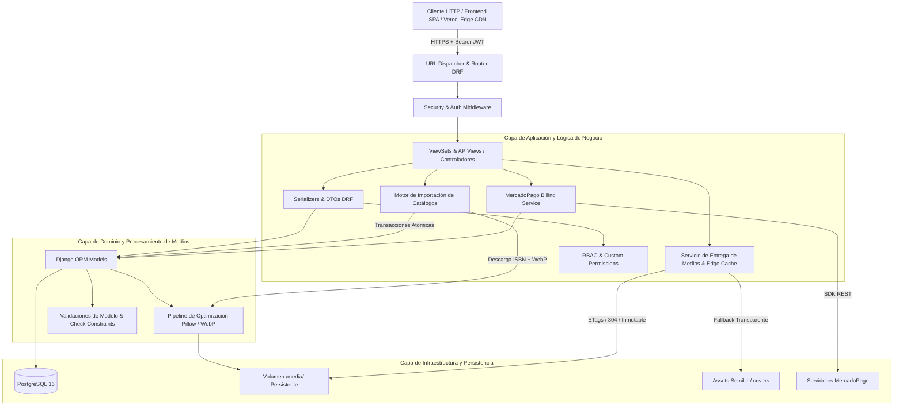

# Folium API — Motor Bibliográfico y Servicio Central RESTful


---

## 1. Visión General y Propósito del Sistema

**Folium API** es el núcleo de persistencia, lógica de negocio y procesamiento de datos para la plataforma bibliotecaria Folium. Ha sido diseñada como una API RESTful modular, segura y altamente escalable, orientada a bibliotecas académicas, archivos históricos y colecciones privadas.

El backend gestiona el ciclo de vida completo de los recursos bibliográficos:
- Catalogación estructurada de obras literarias, autores, editoriales y materias.
- Pipeline de optimización multimedia automática en tiempo real con compresión WebP y redimensionado inteligente.
- Trazabilidad de inventario físico por ejemplar individual con códigos de barra y ubicaciones topográficas en sala.
- Circulación automatizada (préstamos con control de vencimiento y cálculo de mora).
- Sistema de reservas concurrentes y reseñas comunitarias.
- Motor transaccional de importación masiva de catálogos en múltiples estándares internacionales (**MARC 21 ISO 2709**, **MARCXML**, **BibTeX**, **Excel** y **CSV**).
- Facturación institucional integrada con la pasarela de pagos de **MercadoPago** (preferencias de suscripción y webhooks idempotentes).

---

## 2. Arquitectura del Sistema y Patrones de Diseño

El backend adopta una **Arquitectura en Capas Limpia (Layered Clean Architecture)** que aísla estrictamente las responsabilidades entre transporte HTTP, lógica de dominio, persistencia en base de datos e integraciones con servicios de terceros.



### Principales Patrones de Diseño Aplicados

1. **Pipeline de Procesamiento de Medios (Pillow + WebP Optimization)**:
   Ubicado en [`folium_api/image_utils.py`](file:///c:/Users/Facundo/Desktop/ReposGit/folium-api/folium_api/image_utils.py). Todas las imágenes subidas a través de [`Book.save()`](file:///c:/Users/Facundo/Desktop/ReposGit/folium-api/folium_api/models.py) o recuperadas externamente mediante el importador de ISBN son interceptadas, orientadas según metadatos EXIF, redimensionadas proporcionalmente con filtro `LANCZOS` a un máximo de `600×900 px` y codificadas en **WebP (`quality=82`)**. Reduce el peso de las portadas en un ~55% a ~95% sin degradación visual en pantallas de alta densidad.
2. **Entrega de Medios Compatible con Edge CDN (`media_views.py`)**:
   Implementado en [`folium_api/media_views.py`](file:///c:/Users/Facundo/Desktop/ReposGit/folium-api/folium_api/media_views.py). Sirve archivos estáticos multimedia tanto en entornos de desarrollo como en contenedores de producción (`DEBUG=False`). Incluye:
   - **Fallback transparente a `.webp`**: Si el cliente o una URL previa solicita `archivo.jpg` y el archivo fue optimizado a `archivo.webp`, lo resuelve automáticamente evitando errores `404 Not Found`.
   - **Cabeceras Edge CDN**: Emite `ETag`, `Last-Modified`, soporte condicional `304 Not Modified`, `Cache-Control: public, max-age=31536000, s-maxage=31536000, stale-while-revalidate=2592000, immutable` y `Vercel-CDN-Cache-Control`.
3. **Patrón Strategy & Parser Registry (Motor de Importación)**:
   La función `parse_uploaded_file` en [`importer_views.py`](file:///c:/Users/Facundo/Desktop/ReposGit/folium-api/folium_api/importer_views.py) implementa el patrón Estrategia mediante detección polimórfica (por extensión y sniffing byte-level de cabecera). Delega dinámicamente en parsers especializados (`parse_marc21_bytes`, `parse_marcxml_bytes`, `parse_bibtex_text`, `parse_excel_bytes`, `parse_csv_bytes`) sin acoplar la vista a ningún formato específico.
4. **Patrón Service Object (Desacoplamiento de Pagos)**:
   La interacción con la pasarela de MercadoPago está encapsulada en [`mercadopago_service.py`](file:///c:/Users/Facundo/Desktop/ReposGit/folium-api/folium_api/mercadopago_service.py), abstrayendo la SDK oficial, la construcción de preferencias, el catálogo de planes en memoria y la verificación de webhooks.
5. **Transacciones Atómicas (`ACID Transactions`)**:
   Tanto en la ejecución del importador masivo como en el procesamiento de préstamos, devoluciones y el comando de optimización de portadas (`optimize_covers`), se utiliza `transaction.atomic()`. Si un solo registro de un lote falla en modo estricto, la base de datos realiza un rollback completo.
6. **Máquina de Estados Finita (FSM) para Ejemplares y Reservas**:
   Las transiciones de estado de `Item.status` (`AVAILABLE` → `LOANED` → `AVAILABLE` / `DAMAGED` / `LOST`) y `Reservation.status` (`PENDING` → `COMPLETED` / `CANCELLED` / `EXPIRED`) están controladas mediante validaciones explícitas en los métodos `clean()` de los modelos.
7. **Borrado Lógico (Soft Delete)**:
   Entidades críticas como `Book`, `User` y `Review` implementan el campo `deleted_at`. Las consultas habituales excluyen registros con marca de borrado preservando la integridad referencial histórica para préstamos pasados y estadísticas.

---

## 3. Modelo de Dominio y Esquema de Base de Datos


---

## 4. Pipeline de Optimización Multimedia y Comando `optimize_covers`

El backend cuenta con un subsistema nativo de optimización gráfica que opera sin requerir infraestructura ni servicios de pago externos:

### Características Técnicas del Pipeline
* **Formato Estándar**: WebP con compresión adaptativa (`quality=82`, `method=6`).
* **Dimensiones Máximas**: `600×900 px` (escala proporcional con `Image.Resampling.LANCZOS`).
* **Auto-rotación EXIF**: Resuelve automáticamente la orientación de imágenes capturadas con cámaras de teléfonos inteligentes antes de codificar.
* **Preservación Innecesaria**: Si un archivo ya es WebP, cumple las restricciones de dimensiones y su peso es inferior a 85 KB, se preservan sus bytes exactos para evitar pérdidas acumuladas de calidad.

### Ejecución del Comando de Administración `optimize_covers`

Para migrar y optimizar en lote todo el repositorio de imágenes del sistema y sincronizar la base de datos:

```bash
# Ejecutar optimización completa (archivos en disco + actualización en base de datos PostgreSQL)
python manage.py optimize_covers

# En entornos Docker / Producción en AWS EC2:
docker compose exec web python manage.py optimize_covers

# Opciones adicionales:
# Solo optimizar archivos en disco sin tocar la base de datos:
python manage.py optimize_covers --files-only

# Conservar los archivos originales (.jpg, .png) junto al nuevo .webp:
python manage.py optimize_covers --keep-originals
```

> [!NOTE]
> Al ejecutar `optimize_covers`, el comando convierte todos los formatos heredados (`.jpg`, `.jpeg`, `.png`) a `.webp`, actualiza las referencias de `cover_image` en la tabla `Book` mediante una transacción atómica y elimina los archivos duplicados obsoletos, logrando una reducción de más del 50% del almacenamiento en disco.

---

## 5. Motor de Importación Masiva de Catálogos

Ubicado en [`folium_api/importer_views.py`](file:///c:/Users/Facundo/Desktop/ReposGit/folium-api/folium_api/importer_views.py), este módulo permite a los bibliotecarios cargar lotes enteros de libros y ejemplares mediante un asistente en 4 fases:

```
[Archivo Subido] ──> 1. PREVIEW ──> 2. AUTO-MAPPING ──> 3. SIMULATE (Dry Run) ──> 4. EXECUTE (Atomic Commit)
```

### Formatos Soportados y Algoritmos de Parseo

| Formato | Extensiones | Parser / Detección | Características Técnicas |
| :--- | :--- | :--- | :--- |
| **MARC 21 Binario** | `.mrc`, `.marc`, `.dat` | `parse_marc21_bytes` (ISO 2709) | Decodifica líder de 24 bytes, extrae directorio de etiquetas de 12 bytes, lee subcampos delimitados por `\x1f`, terminadores de campo `\x1e` y de registro `\x1d`. Normaliza puntuación ISBD. |
| **MARCXML** | `.xml`, `.marcxml` | `parse_marcxml_bytes` (XML ElementTree) | Soporta namespace oficial de la Library of Congress (`http://www.loc.gov/MARC21/slim`), procesando `<controlfield>` y `<datafield>` anidados. |
| **BibTeX** | `.bib` | `parse_bibtex_text` (Regex AST) | Extrae entradas `@book{...}`, mapeando campos `title`, `author`, `isbn`, `publisher`, `year`, `keywords`, `abstract`. |
| **Planillas Excel** | `.xlsx` | `parse_excel_bytes` (Zipfile + XML) | Lector ligero nativo sin dependencias pesadas tipo openpyxl/pandas. Extrae `sharedStrings.xml` y celdas de `sheet1.xml`. |
| **Delimitados CSV/TSV** | `.csv`, `.tsv`, `.txt` | `parse_csv_bytes` (`csv.Sniffer`) | Detección automática de codificación (`UTF-8`, `UTF-8-SIG` con BOM, `Latin-1`, `CP1252`) y delimitador (`;`, `,`, `\t`, `\|`). |

### Búsqueda y Optimización de Portadas por ISBN
Durante la importación masiva con la opción `fetch_covers_by_isbn` activa:
1. **Nivel 1 (Local)**: Consulta `media/books/covers/<isbn>.webp` o `seed_assets/covers/<isbn>.webp`.
2. **Nivel 2 (Open Library Covers API)**: Descarga la versión en alta resolución.
3. **Nivel 3 (Google Books API)**: Fallback para libros en español.
4. **Optimización Inmediata**: Cualquier portada remota descargada es convertida a WebP (`<=600x900px`) en memoria antes de guardarse en disco.

---

## 6. Módulo de Facturación y Suscripciones (MercadoPago)

Ubicado en [`folium_api/mercadopago_service.py`](file:///c:/Users/Facundo/Desktop/ReposGit/folium-api/folium_api/mercadopago_service.py) y [`folium_api/billing_views.py`](file:///c:/Users/Facundo/Desktop/ReposGit/folium-api/folium_api/billing_views.py):

- **Catálogo de Planes Institucionales**:
  - `PLAN_POPULAR` ($29.900 ARS/mes): Hasta 5.000 títulos, importador masivo completo (Excel, CSV, BibTeX, MARC 21, MARCXML), 3 cuentas de bibliotecario.
  - `PLAN_ACADEMIC` ($59.900 ARS/mes): Hasta 25.000 títulos, 10 bibliotecarios, soporte de preservación digital.
  - `PLAN_NETWORK` ($119.900 ARS/mes): Obras ilimitadas, multi-sucursal, API dedicada.
- **Flujo de Pago**:
  1. El cliente envía `POST /api/v1/billing/checkout/` con el `plan_id`.
  2. El servicio genera la preferencia en MercadoPago configurando `back_urls` (éxito, fallo, pendiente), `auto_return: approved` y metadatos de auditoría.
  3. Devuelve `init_point` para redirección transparente del usuario.
  4. Los eventos de notificación IPN son recibidos en `POST /api/v1/billing/webhook/mercadopago/`, consultando el estado del pago mediante el SDK oficial y activando los permisos institucionales.

---

## 7. Catálogo de Endpoints de la API

Todas las rutas de la API están prefijadas por `/api/v1/`.

### Autenticación y Cuentas
| Método | Endpoint | Acceso | Descripción |
| :--- | :--- | :--- | :--- |
| `POST` | `/token/` | Público | Obtención de tokens JWT (`access` y `refresh`) mediante `username` y `password`. Devuelve claims con rol. |
| `POST` | `/token/refresh/` | Público | Renovación del `access` token mediante un `refresh` token válido. |
| `POST` | `/register/` | Público | Autoregistro de nuevos lectores (`USER`). Valida DNI, email y contraseña. |
| `GET` | `/me/` | Autenticado | Perfil detallado del usuario en sesión, estadísticas de lectura y rol. |
| `PATCH` | `/me/` | Autenticado | Actualización de datos de perfil (nombre, apellido, teléfono). |

### Catálogo de Obras y Autores
| Método | Endpoint | Acceso | Descripción |
| :--- | :--- | :--- | :--- |
| `GET` | `/book/` | **Público** (`AllowAny`) | Listado paginado de libros con filtros multicriterio (`search`, `genre`, `editorial`, `year`). Optimizado con `select_related`/`prefetch_related`. |
| `POST` | `/book/` | Staff (`LIBRARIAN`, `ADMIN`) | Alta de obra con autores, géneros y subida multipart de portada (`cover_image` optimizada a WebP). |
| `GET` | `/book/{id}/` | **Público** (`AllowAny`) | Ficha técnica completa de la obra, autores, géneros, stock disponible y promedio de calificaciones. |
| `PUT`/`PATCH` | `/book/{id}/` | Staff | Modificación de metadatos de la obra. |
| `DELETE` | `/book/{id}/` | Staff | Borrado lógico (`deleted_at = timezone.now()`). |
| `GET` | `/author/` | Público | Listado de autores registrados. |
| `POST` | `/author/` | Staff | Registro de nuevo autor. |
| `GET` | `/genre/` | Público | Listado de géneros y materias bibliográficas. |
| `GET` | `/editorial/` | Público | Listado completo de editoriales registradas para selectores y filtros. |
| `POST` | `/editorial/` | Staff | Registro de nueva editorial. |
| `GET` | `/random/` | Público | Devuelve un libro aleatorio para recomendaciones en landing. |
| `GET` | `/recommendations/` | Público | Sugerencias literarias basadas en popularidad o similitud. |

### Ejemplares Físicos e Inventario (`/items/`)
| Método | Endpoint | Acceso | Descripción |
| :--- | :--- | :--- | :--- |
| `GET` | `/items/` | Staff | Listado de ejemplares con filtros por código de inventario, libro y estado. |
| `POST` | `/items/` | Staff | Registro de nuevo ejemplar vinculado a un libro (`inventory_code`, `status`, `location`). |
| `PATCH` | `/items/{id}/` | Staff | Cambio de estado o reubicación de sala. |

### Circulación y Préstamos (`/loan/`)
| Método | Endpoint | Acceso | Descripción |
| :--- | :--- | :--- | :--- |
| `GET` | `/loan/` | Autenticado | Lista préstamos propios para `USER` o globales para `LIBRARIAN`/`ADMIN`. Acepta filtros `user` (nombre, apellido, email, username o ID), `item` (título, código de inventario o ID), `status` (`active`, `overdue`, `returned`) y ordenamiento mediante `ordering` (`item`, `id`, `-id`, `loaned_at`, `-loaned_at`, `remaining`, `-remaining`). Paginado con `page` y `page_size` (20 por defecto, máximo 50); devuelve `count`, `next`, `previous`, `results` y `summary`: `due_today` cuenta los préstamos sin devolución cuya fecha local de vencimiento es hoy; `due_total` cuenta todos los préstamos sin devolución, incluidos los vencidos; `overdue` cuenta los préstamos sin devolución cuya fecha de vencimiento ya pasó. El resumen se calcula sobre todos los préstamos visibles para el usuario autenticado y no cambia con los filtros ni la página. El orden `remaining` agrupa activos, vencidos y devueltos en ese orden; el prefijo `-` invierte el orden dentro de cada grupo. |
| `POST` | `/loan/` | Staff | Creación de préstamo asociando un `Item` disponible a un `User`. Cambia el estado del ítem a `LOANED`. |
| `POST` | `/loan/{id}/return_book/` | Staff | Registra `returned_at = now()` y devuelve el ítem a `AVAILABLE` de forma atómica. |

### Reservas y Reseñas
| Método | Endpoint | Acceso | Descripción |
| :--- | :--- | :--- | :--- |
| `GET` | `/reservations/` | Autenticado | Devuelve una lista completa, sin paginación, de las reservas propias para `USER` o globales para `LIBRARIAN`/`ADMIN`. Acepta filtros opcionales `user` (nombre, apellido, username, email o ID exacto), `book` (título, ISBN o ID exacto), `status` (`pending`, `expired`, `completed`, `cancelled`) y ordenamiento `ordering` (`created_at`, `-created_at`, `title`). El orden por fecha prioriza pendientes vigentes, expiradas, completadas y canceladas; dentro de cada grupo aplica la dirección de fecha elegida. Las reservas `PENDING` con `expires_at` pasado se consideran expiradas para filtrar, ordenar y contar. |
| `GET` | `/reservations/summary/` | Autenticado | Devuelve los conteos visibles para el usuario autenticado: `pending`, `completed` y `cancelled`. Las pendientes expiradas no se incluyen en `pending`. |
| `POST` | `/reservations/` | Autenticado (`USER`) | Reserva un libro sin stock disponible inmediato. Asigna fecha de expiración por defecto. |
| `PATCH` | `/reservations/{id}/` | Autenticado | Cancelación voluntaria por parte del usuario o resolución por bibliotecario. |
| `GET` | `/reviews/?book={id}` | Público | Lista de reseñas y comentarios aprobados para un libro. |
| `POST` | `/reviews/` | Autenticado (`USER`) | Publica una calificación (1 a 5) y comentario para una obra leída. |

### Entrega de Archivos Multimedia (Nivel Raíz)
| Método | Endpoint | Acceso | Descripción |
| :--- | :--- | :--- | :--- |
| `GET` | `/media/{path}` | Público | Entrega optimizada de portadas con soporte ETag, 304 Not Modified, cabeceras CDN inmutables y fallback transparente a WebP. |

---

## 8. Seguridad, Autorización y RBAC

1. **Tokens JWT Personalizados**:
   Implementados con `django-rest-framework-simplejwt`. La vista `FoliumTokenObtainPairView` inyecta en el payload del token los claims `user_id`, `username`, `email` y `rol`.
2. **Matriz de Control de Acceso (RBAC)**:
   - `IsLibrarianOrAdminUser`: Permiso personalizado que valida si `request.user.rol` es `LIBRARIAN` o `ADMIN`, o si el usuario tiene `is_staff=True`.
   - `BookViewSet`: Lectura pública (`AllowAny`), mutación reservada a `IsLibrarianOrAdminUser`.
   - Restricción por Ownership: En vistas como `/reservations/` o `/loan/`, los lectores solo pueden consultar y operar sobre sus propios registros, mientras que los bibliotecarios tienen visibilidad global.
3. **Validación Criptográfica y de Integridad**:
   - Algoritmo de verificación de ISBN (10 y 13 dígitos) con cálculo de dígito verificador.
   - Prevención de inyección SQL mediante el uso estricto del ORM de Django.
   - Sanitización de nombres contra vectores XSS mediante expresiones regulares en los modelos.
4. **Protección de Datos y Manejo de Errores**:
   - En modo producción (`DEBUG=False`), los errores 500 omiten trazas internas sensibles y devuelven respuestas JSON homogéneas.

---

## 9. Despliegue, Migraciones y Guía de Operaciones

### Pasos de Despliegue en Servidor (AWS EC2 / Producción)

Para poner en producción los últimos cambios de backend (incluyendo la migración a WebP y el soporte CDN):

```bash
# 1. Traer los últimos cambios de la rama testing o main
git pull origin testing

# 2. Reconstruir los contenedores Docker
docker compose down
docker compose up --build -d

# 3. Aplicar migraciones del esquema de base de datos
docker compose exec web python manage.py migrate

# 4. Optimizar y migrar todas las portadas existentes a WebP
docker compose exec web python manage.py optimize_covers

# 5. Verificar estado de los contenedores y logs (NO ejecutar seed_data en producción)
docker compose ps
docker compose logs -f web
```

### Ejecución Local sin Docker (Entorno Virtual)

```bash
# 1. Crear y activar entorno virtual
python -m venv .venv
source .venv/bin/activate       # En Linux / macOS
# .venv\Scripts\activate        # En Windows PowerShell

# 2. Instalar dependencias
pip install -r requirements.txt

# 3. Aplicar migraciones y optimizar medios
python manage.py migrate
python manage.py optimize_covers
python manage.py runserver 8000
```

### Ejecución de Pruebas Automatizadas

```bash
# Ejecutar toda la suite de pruebas unitarias
docker compose exec web python manage.py test folium_api

# Ejecutar tests con verbosidad detallada
docker compose exec web python manage.py test folium_api -v 2
```
